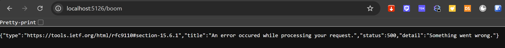
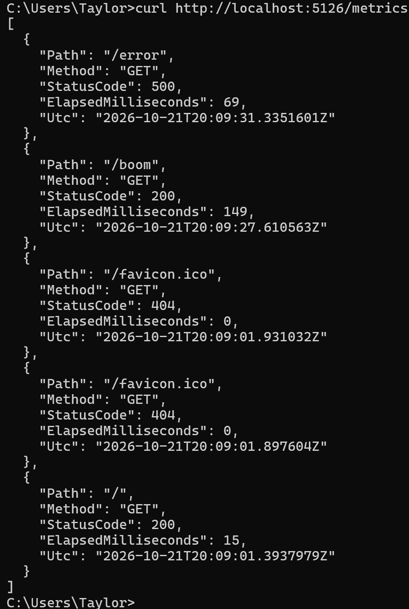

# Metrics App

This metrics app allows the user to build off of this project using the metrics/error logger as a backbone to the project. This allows the developer to view when requests happen, and what they are for. They also let the developer to see how long they took, and whether or not they gave the end user an error.

# Example

